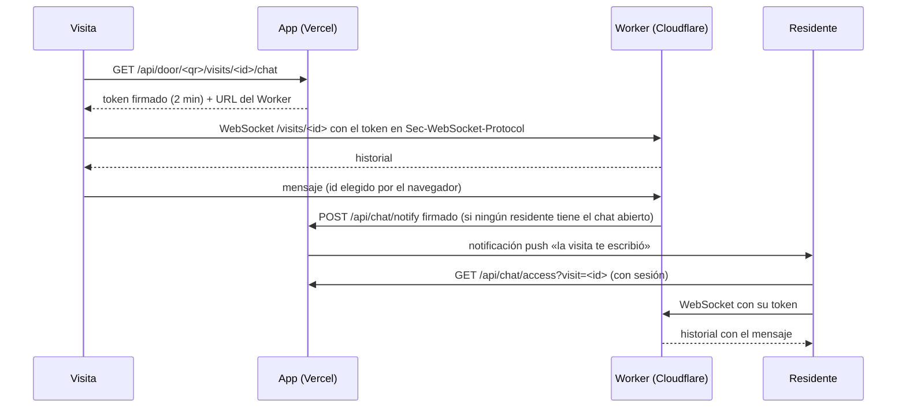

# Chat con la visita

La visita y los residentes pueden escribirse en vivo durante los 15 minutos siguientes al timbrazo. El chat corre en un Worker de Cloudflare (`chat/`) con un Durable Object por visita. Vercel no puede mantener WebSockets abiertos, así que la app solo emite los permisos y recibe los avisos. Es opcional: sin `CHAT_URL` y `CHAT_SECRET`, la visita ve la nota de siempre.

## Cómo funciona



- **Permisos:** la app firma tokens HMAC-SHA256 con `CHAT_SECRET`. Un token sirve para una visita, un rol (visita o residente) y la página que lo pidió (uno de los orígenes de la app: un preview responde en su URL de rama y en la del deployment), y vence a los 2 minutos; cada reconexión pide otro. El Worker rechaza los tokens de otra visita, vencidos, firmados con otro secreto o usados desde otra página. La sala se nombra con el origen canónico de la app, así que todas sus páginas la comparten. El token viaja en `Sec-WebSocket-Protocol`, nunca en la URL, así que no queda en los logs.
- **La visita** obtiene su token con lo que solo ella tiene: el QR y el id del timbrazo. Después de los 15 minutos ya no recibe tokens.
- **Los residentes** obtienen el suyo con su sesión, si son residentes de la casa de esa visita. Entran con el nombre que les da la casa y pueden leer el chat mientras la visita siga en el historial (30 días).
- **Privacidad:** la visita nunca ve quién respondió. El Worker le manda los mensajes de los residentes sin nombre y la página muestra el nombre de la casa.
- **Avisos:** cuando la visita escribe y ningún residente tiene el chat abierto, el Worker le pide a la app que avise, como mucho una vez por minuto por visita. El pedido va firmado con el mismo secreto y con su hora: la app rechaza firmas inválidas, pedidos con más de 5 minutos de diferencia y visitas con el chat cerrado. La notificación vence a los 15 minutos y abre la visita con su chat. Una pestaña oculta cierra su socket, así un panel olvidado abierto en la compu no apaga los avisos de los celulares.
- **Envíos:** cada mensaje lleva un id elegido por el navegador y el Durable Object lo guarda una sola vez. Lo que se escribe sin conexión sale al reconectar, y «Reintentar» nunca lo duplica. Cada visita acepta hasta 100 mensajes de hasta 300 caracteres.
- **Retención:** el Durable Object guarda los mensajes en su propia SQLite. Una alarma los borra a los 30 días del cierre del chat, como las visitas del historial.

## Costo

Con el plan **Workers Free** alcanza: los Durable Objects con SQLite están incluidos, hasta 100.000 requests por día. Cada conexión cuenta como un request; los mensajes que llegan al Worker cuentan 1 cada 20 y los que salen no se cobran. Mientras nadie escribe, el objeto hiberna y no se cobra duración. Si un día se pasa el límite, las operaciones fallan en vez de facturar; el plan **Workers Paid** arranca en USD 5 por mes.

## Desarrollo local

1. Copiá `chat/.dev.vars.example` a `chat/.dev.vars` y poné un `CHAT_SECRET` de al menos 32 caracteres (por ejemplo, `node -e "console.log(crypto.randomBytes(32).toString('base64url'))"`).
2. En `.env.local`: `CHAT_URL=ws://localhost:8787` y el mismo `CHAT_SECRET`.
3. `npm run chat:dev` en una terminal y `npm run dev` en otra.

El Worker local llama a `http://localhost:3000/api/chat/notify` porque esa es la URL que firma el token.

## Despliegue

Una sola vez, desde la raíz del repo:

```sh
npx wrangler login
npx wrangler secret put CHAT_SECRET --config chat/wrangler.jsonc
npm run chat:deploy
```

`chat:deploy` imprime la URL del Worker (`https://ringgg-chat.<cuenta>.workers.dev`). En Vercel, en Production (y en Preview si querés el chat ahí), configurá:

- `CHAT_URL=wss://ringgg-chat.<cuenta>.workers.dev`
- `CHAT_SECRET=` el mismo valor que cargaste con `wrangler secret put`

Un build de producción con una sola de las dos variables, con `CHAT_URL` sin `wss://` o con un secreto corto falla en `next.config.ts`.

Los previews con Deployment Protection de Vercel rechazan el aviso del Worker (no tiene sesión de Vercel): en un preview el chat funciona, pero sin notificaciones push de los mensajes.

## Pruebas

- `tests/chat-worker.test.ts` levanta el Worker real con el harness de wrangler (workerd, Durable Objects, SQLite y alarmas) y prueba accesos, mensajes, reintentos, avisos firmados y retención.
- `tests/chat.test.ts` prueba tokens, accesos de la visita y de los residentes, y los avisos con PostgreSQL embebido y el proveedor de push simulado en la red.
- `tests/e2e/visit-chat.spec.ts` abre la visita y el panel en Chromium contra el Worker real: chat en vivo, privacidad, reconexión sin duplicados y cierre de la ventana.

Después de cambiar `chat/wrangler.jsonc`, regenerá los tipos con `npm run chat:types`.
